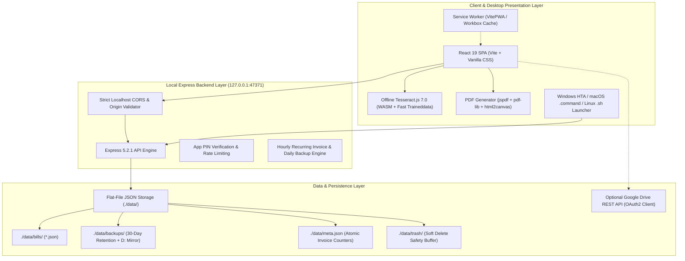

# PROJECT DETAILS — PART 1: SYSTEM VISION, ARCHITECTURE & TECH STACK

> [!NOTE]
> Modular documentation partition 1 of 3. Safe character ceiling: < 9,500 characters.
> Indexed by [PROJECT_DETAILS.md](file:///c:/Users/Forum/Documents/Antigravuty%20apps/free-gst-billing-software/PROJECT_DETAILS.md).

---

## 1. SYSTEM VISION & PRODUCT OVERVIEW

**Free GST Billing Software** (created by DiceCodes / IamRamgarhia, v1.10.82) is an open-source, privacy-first, offline-first billing, tax compliance, and inventory management suite designed specifically for Indian micro, small, and medium enterprises (MSMEs), traders, professionals, and freelancers.

### Core Value Propositions
1. **100% Privacy & Local Storage**: No mandatory cloud subscription or third-party data tracking. All invoices, client GSTINs, supplier books, and bank accounts reside strictly on the user's computer in `./data/`.
2. **Indian Statutory Compliance**: Native compliance with the Central Goods and Services Tax Act, 2017 (CGST/SGST/IGST/UTGST), TDS (Section 194Q / 194J / 194C), TCS (Section 206C(1H)), e-Way Bill JSON generation, and direct exports for GSTR-1, GSTR-3B, and GSTR-2B reconciliation.
3. **Tally ERP & Prime Interoperability**: 1-click XML export for CA voucher import (Sales, Purchases, Credit Notes, Receipts with `Agst Ref` allocations) and 1-click Tally master migration (Sundry Debtors, Creditors, and Stock Items).
4. **Billing & Stock Intelligence**: In-bill party-wise rate and quantity memory, live GSTIN portal auto-lookup, and full item movement ledger (`Opening + In - Out = Closing`).
5. **Multi-Firm & Multi-GSTIN Support**: Single-installation management of multiple business profiles, each retaining an independent sequence number series or sharing a global series.
6. **Offline PWA & Native Launchers**: Hybrid desktop packaging supporting Windows (`.hta` and PowerShell 5.1), macOS (`.command`), and Linux (`.sh`), with optional Google Drive backup sync.

---

## 2. CORE BUSINESS & STATUTORY COMPLIANCE MODEL

### 1. Document Lifecycle
The application supports seven core commercial and statutory document types:
- **Tax Invoice (`INV`)**: Commercial sale of taxable goods/services to B2B or B2C parties.
- **Bill of Supply (`BOS`)**: Non-taxable supplies (composition scheme dealers or exempt items).
- **Proforma Invoice / Estimate (`EST`)**: Pre-sale quotations converted to tax invoices upon payment.
- **Quotation (`QUO`)**: Formal commercial quotes with configurable expiry.
- **Delivery Challan (`DC`)**: Movement of goods without immediate sale (job work / approval).
- **Credit Note (`CN`)**: Downward revision of sale value or returned goods (Section 34).
- **Receipt Voucher (`RCP`)**: Proof of payment receipt with auto-reconciliation against unpaid bills.

### 2. Tax Determination Engine
- **Interstate vs. Intra-State Logic**: Automatically compares the 2-digit state code of the Supplier's GSTIN/State against the Place of Supply (POS) code.
  * Same State $\rightarrow$ **CGST** (50%) + **SGST** (50%).
  * Union Territory without Legislature (Chandigarh, Ladakh, DNH-DD, A&N, Lakshadweep) $\rightarrow$ **CGST** (50%) + **UTGST** (50%).
  * Different State / SEZ Developer / Export Client $\rightarrow$ **IGST** (100%).
- **Reverse Charge Mechanism (RCM)**: RCM sales omit tax from receivable totals; tax liability shifts to the buyer while preserving statutory reporting line items.
- **TDS / TCS ₹50 Lakh Cumulative Threshold**: Implements CBDT Circulars 23/2017, 13/2021, and 17/2020. TDS (Section 194Q) base excludes GST; TCS (Section 206C(1H)) base includes gross receipt.

---

## 3. ARCHITECTURE DIAGRAM

---

## 4. TECHNOLOGY STACK MATRIX

| Subsystem | Technology | Version | Purpose |
|---|---|---|---|
| **Frontend Framework** | React | 19.3.0 | UI rendering with functional components & hooks |
| **DOM Renderer** | React-DOM | 19.3.0 | Core reconciliation engine |
| **Build & Dev Tool** | Vite | 7.3.7 | Fast HMR dev server & production bundler |
| **PWA Engine** | vite-plugin-pwa | 1.3.0 | Workbox service worker & offline asset caching |
| **Styling** | Vanilla CSS | Custom | Modern responsive styling in `src/index.css` (119KB) |
| **Icons** | lucide-react | 0.577.0 | Vector iconography across all views |
| **Local API Server** | Express | 5.2.1 | Native REST API server listening on `127.0.0.1` |
| **PDF Generation** | jspdf / pdf-lib | 4.2.1 / 1.17.1 | Vector PDF document generation & manipulation |
| **Screen Rasterizer** | html2canvas | 1.4.1 | High-fidelity invoice visual cloning |
| **QR Code Engine** | qrcode | 1.5.4 | Dynamic UPI Payment QR code generation |
| **Offline OCR** | tesseract.js | 7.0.0 | Supplier bill scan to purchase line items |
| **Spreadsheet Compression** | fflate | 0.8.3 | Ultra-fast XLSX export compression |
| **HTML Sanitizer** | dompurify | 3.4.17 | XSS prevention for rich-text terms & previews |
| **Test Automation** | Playwright | 1.63.0 | Cross-browser smoke & visual regression suite |
| **Runtime Environment** | Node.js | $\ge$ 18.0.0 | Host runtime (Windows host running Node v25.2.1) |

---

## 5. HOSTING & DEPLOYMENT TOPOLOGIES

### 1. Default Topology: Offline Desktop Localhost (Primary)
- The server runs on `127.0.0.1:47371` (automatically scanning ports up to 47421 if occupied).
- Launched via `Free GST Billing - WINDOWS.hta`, `install.ps1`, or root `index.html`.
- Zero network dependency. Data stored on local disk under `./data/`.

### 2. Multi-Device LAN / Self-Hosted Cloud (Documented in `docs/DEPLOY_ONLINE.md`)
- **Option A (Persistent Container - Railway / Render / Fly.io)**:
  Runs `npm start` with a persistent volume mounted at `/app/data`. Requires HTTP Basic Auth and CORS allowlist update.
- **Option B (Serverless - Vercel + Supabase)**:
  Static PWA deployed to Vercel CDN; backend transitioned to Supabase PostgreSQL with RLS and Supabase Auth.
- **Option C (Cloudflare Tunnel)**:
  Zero-trust Cloudflare Tunnel forwarding requests to the local machine without opening router ports.
- **Option D (Oracle Cloud Always-Free Compute VM)**:
  Ubuntu 24.04 LTS instance (ap-mumbai-1) running Node.js 22 + PM2 daemon with systemd persistence. Ingress port 47371 open via VCN Security List and OS iptables; `HOST=0.0.0.0` environment variable for web listening.

---

## 6. UPSTREAM REPOSITORY & VERSION COMPARISON PROTOCOL

- **Canonical Upstream Repository**: [IamRamgarhia/Free-GST-Billing-Software](https://github.com/IamRamgarhia/Free-GST-Billing-Software)
- **Live Upstream Releases Feed**: `https://api.github.com/repos/IamRamgarhia/Free-GST-Billing-Software/releases/latest`
- **Synchronization Directive**:
  1. In every auditing, enhancement, or maintenance session, verify the local package version against the upstream GitHub release tag.
  2. If upstream publishes updates (e.g. revised GST rate schedules, CBIC portal format changes, bug fixes), inspect the upstream diffs and release notes.
  3. Evaluate whether upstream changes are beneficial for our application.
  4. Selectively port and test necessary features/fixes while preserving local customizations, verifying via `npm run test:unit` (345+ passing assertions) and `npm run build`.

